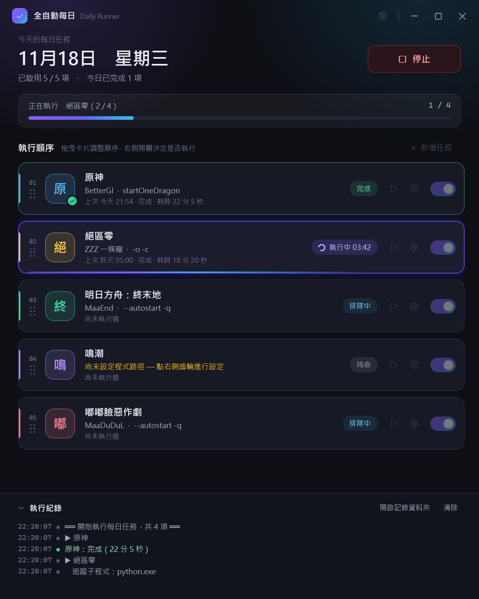
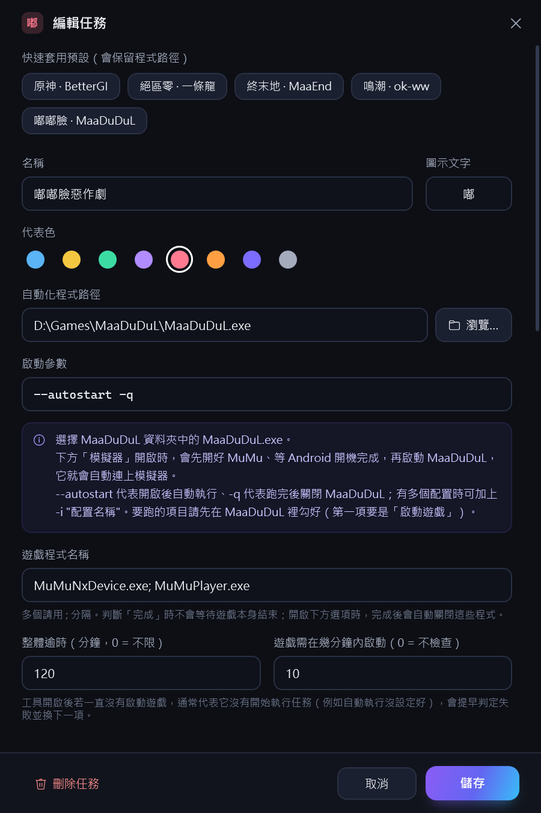
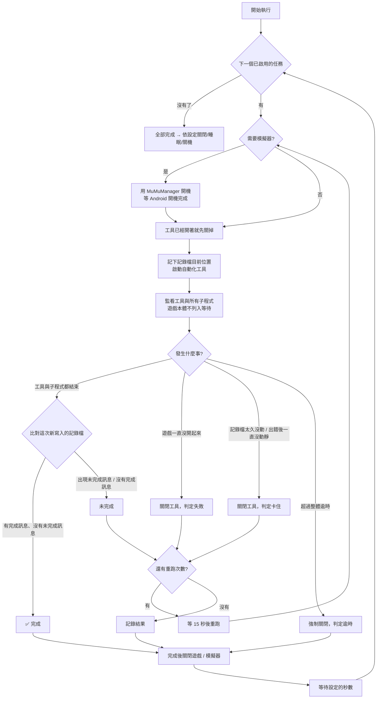
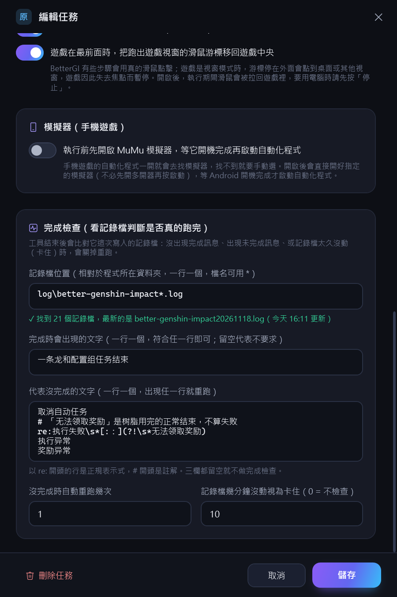
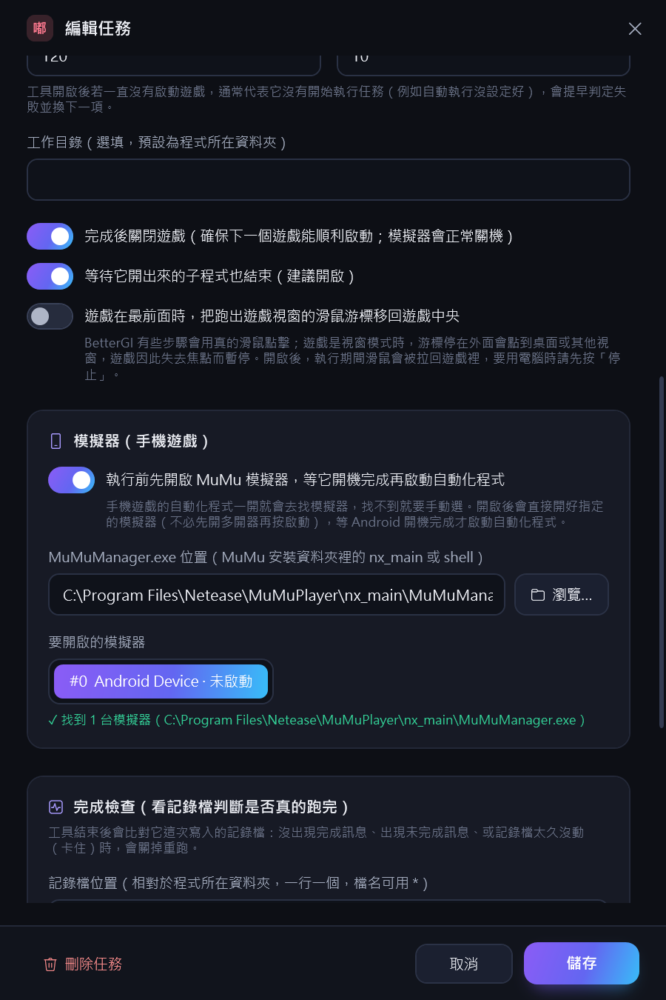

# 全自動每日（AutoDaily）

> 把各款遊戲的「每日自動化工具」串成一條流水線：一鍵（或每天定時）依序跑完原神、絕區零、終末地、鳴潮、嘟嘟臉惡作劇……並且**看記錄檔確認真的跑完**，沒跑完就自動重跑。




每款遊戲都有社群做的每日自動化工具（BetterGI、ZZZ 一條龍、MaaEnd、ok-ww、MaaDuDuL…），但每天要一個一個打開、等它跑完、再開下一個，還是很麻煩。
全自動每日負責「排隊」：依你排好的順序一次啟動一個工具，等它（和它開出來的所有子程式）真的結束、確認記錄檔顯示完成，才換下一個。

---

## 目錄

- [功能特色](#功能特色)
- [支援的遊戲與工具](#支援的遊戲與工具)
- [下載與安裝](#下載與安裝)
- [快速開始](#快速開始)
- [各工具需要先設定的地方](#各工具需要先設定的地方)
- [執行流程：怎麼判斷「跑完了」](#執行流程怎麼判斷跑完了)
- [完成檢查與自動重跑](#完成檢查與自動重跑)
- [手機遊戲（MuMu 模擬器）](#手機遊戲mumu-模擬器)
- [把滑鼠游標留在遊戲裡](#把滑鼠游標留在遊戲裡)
- [任務設定欄位說明](#任務設定欄位說明)
- [程式設定與每天定時執行](#程式設定與每天定時執行)
- [加入其他工具](#加入其他工具)
- [常見問題](#常見問題)
- [自行建置與開發](#自行建置與開發)
- [注意事項](#注意事項)
- [致謝](#致謝)

---

## 功能特色

| | |
|---|---|
| 🔗 **依序執行** | 一次只跑一個工具，前一個完全結束才開下一個，避免多款遊戲搶顯示卡、搶焦點。 |
| 🖱️ **拖曳排序、個別開關** | 卡片可以直接拖曳調整順序；右側開關決定今天要不要跑；▶ 可以單獨跑某一項來測試。 |
| ✅ **確認真的跑完** | 讀取各工具「這次執行期間新寫入」的記錄檔，比對完成／未完成訊息，工具自己結束不代表成功。 |
| 🔁 **自動重跑** | 沒跑完、卡住、異常結束時自動再跑一次（次數可調）。 |
| 🧭 **卡住偵測** | 遊戲開起來後記錄檔太久沒動、或工具一直沒把遊戲開起來，都會提早判定並換下一項。 |
| 📱 **手機遊戲** | 自動開好 MuMu 模擬器、等 Android 開機完成再啟動自動化程式，跑完正常關機。 |
| 🎯 **防止失焦** | 視窗模式的遊戲在前景時，把跑出視窗的滑鼠游標拉回遊戲，避免真實點擊點到別的視窗。 |
| ⏰ **每天定時** | 透過 Windows 工作排程器每天自動執行，可補執行、可喚醒電腦；跑完可以關機或睡眠。 |
| 📦 **單一執行檔** | 免安裝、不需另裝 .NET；設定與記錄都放在 exe 旁邊，整個資料夾可直接搬移。 |

## 支援的遊戲與工具

內建以下預設（啟動參數、完成判斷都已設定好），選好工具的 exe 就能用：

| 遊戲 | 自動化工具 | 預設參數 | 意義 |
|---|---|---|---|
| 原神 | [BetterGI](https://github.com/babalae/better-genshin-impact) | `startOneDragon` | 啟動後直接執行一條龍 |
| 絕區零 | [ZZZ 一條龍](https://github.com/OneDragon-Anything/ZenlessZoneZero-OneDragon) | `-o -c` | 執行一條龍，完成後關閉遊戲 |
| 明日方舟：終末地 | [MaaEnd](https://github.com/MaaEnd/MaaEnd) | `--autostart -q` | 自動執行指定配置，完成後關閉 MaaEnd |
| 鳴潮 | [ok-ww](https://github.com/ok-oldking/ok-wuthering-waves) | `-t 1 -e` | 執行第 1 個任務，完成後關閉遊戲與 ok-ww |
| 嘟嘟臉惡作劇（手機） | [MaaDuDuL](https://github.com/kqcoxn/MaaDuDuL) ＋ MuMu 模擬器 | `--autostart -q` | 先開好模擬器，再自動執行目前的配置，完成後關閉 MaaDuDuL |

不在清單裡的工具也可以加，見[加入其他工具](#加入其他工具)。

## 下載與安裝

1. 到 [Releases](https://github.com/ZerooNight/AutoDaily/releases/latest) 下載 `AutoDaily.exe`。
2. 放到一個**自己的資料夾**（例如 `D:\AutoDaily\`），因為設定檔 `config.json` 與 `logs\` 會建在 exe 旁邊。
3. 執行 `AutoDaily.exe`。程式會要求**系統管理員權限**，因為這些自動化工具本身都需要管理員權限，由非管理員程式啟動會失敗。

系統需求：Windows 10 / 11 64 位元。不需要另外安裝 .NET（執行檔已內含）。

## 快速開始

1. 第一次開啟會看到五張預設卡片。點卡片右側 **⚙ 齒輪**。
2. 按 **瀏覽…** 選擇該工具的主程式（例如 `BetterGI.exe`），按 **儲存**。選到認得的工具時會自動套用預設參數。
3. 不玩的遊戲把右側 **開關** 關掉；**拖曳卡片** 左側的點點調整順序。
4. 每張卡片的 **▶** 可以只跑那一項，第一次建議每項都單獨測一次。
5. 按右上角 **開始執行**，就會一個接一個跑完；下方「執行紀錄」會即時顯示每一步。
6. 想每天自動跑：右上角 **設定** → 開啟「每天定時自動執行」，見[程式設定](#程式設定與每天定時執行)。



## 各工具需要先設定的地方

全自動每日只負責「依序啟動自動化工具並確認結果」，遊戲是由各工具自己開的。所以每個工具都要先能**自己**完整跑完一次：設好遊戲路徑、要跑的項目，以及「跑完後自己結束」。

### 原神 · BetterGI
- 程式路徑選 BetterGI 資料夾中的 `BetterGI.exe`。
- 到 **一條龍** 頁面，把「完成後操作」設為 **關閉遊戲和軟件**。否則 BetterGI 跑完不會結束，本程式會一直等到逾時。
- 想指定一條龍配置：參數改成 `startOneDragon 你的配置名稱`。
- 想指定解析度／視窗模式：BetterGI「首頁 → 同時啟動原神 → 啟動參數」可以填 Unity 參數，例如 `-screen-width 1920 -screen-height 1080 -screen-fullscreen 0`。
- 預設開啟[把滑鼠游標留在遊戲裡](#把滑鼠游標留在遊戲裡)。

### 絕區零 · ZZZ 一條龍
- 程式路徑選安裝資料夾中的啟動器（`OneDragon` 開頭的 exe）。
- 參數 `-o` 代表執行一條龍、`-c` 代表完成後關閉遊戲；多帳號可再加 `-i 1,2` 指定實例。
- 一條龍會記住今天已完成的項目，重跑時只會補做沒完成的部分。

### 明日方舟：終末地 · MaaEnd
- 程式路徑選 MaaEnd 資料夾中的 `MaaEnd.exe`。
- **必須**讓 MaaEnd 知道要跑哪個配置，二選一：
  - 參數加上 `-i "配置名稱"`（名稱要和 MaaEnd 上方配置分頁完全相同），例如 `--autostart -i "全套日常" -q`。
  - 或在 MaaEnd「設定 → 啟動後自動執行」選擇配置（預設是「不自動執行」，這樣開啟後什麼都不會做）。
- 配置的「前置程式」記得填遊戲路徑，MaaEnd 才會自己開遊戲。

### 鳴潮 · ok-ww
- 程式路徑選 ok-ww 安裝資料夾中的 `ok-ww.exe`。
- `-t 1` 代表執行 ok-ww 任務清單中的第 1 個任務，請確認它是一條龍／日常；不是的話改成對應的編號。`-e` 代表完成後關閉遊戲與 ok-ww。

### 嘟嘟臉惡作劇 · MaaDuDuL（MuMu 模擬器）
- 程式路徑選 MaaDuDuL 資料夾中的 `MaaDuDuL.exe`。
- 在 MaaDuDuL 裡勾好要跑的項目，**第一項要是「啟動遊戲」**。
- 有多個配置時在參數加上 `-i "配置名稱"`。
- MaaDuDuL「啟動設定 → 啟動前操作」維持 **無**：模擬器改由全自動每日負責開，見[手機遊戲](#手機遊戲mumu-模擬器)。

> 💡 開始執行時，如果某個工具已經開著（例如手動測試完沒關），全自動每日會**先把它關掉再重新啟動**。
> 這些工具大多只能開一個，再開一次只會把指令交給舊視窗就立刻結束，新的那個不會自動執行。

## 執行流程：怎麼判斷「跑完了」



細節：

- **等待整個程式樹**：有些 exe 只是啟動器（開完 python 就自己關掉），所以會一路追蹤它開出來的所有子程式，全部結束才算結束。
- **遊戲本體不等**：「遊戲程式名稱」列出的程式不列入等待；開啟「完成後關閉遊戲」時，結束後會把遊戲關掉（模擬器則用正常關機），確保下一個遊戲能順利啟動。
- **背景常駐程式不等**：`adb.exe`、`conhost.exe`、當機回報程式等會被忽略，可在設定中增加。
- **工具沒開始跑**：工具開啟後若一直沒有把遊戲開起來（預設 10 分鐘），通常代表它沒有開始執行（例如 MaaEnd 沒指定配置），會提早判定失敗。
- **太快結束**：20 秒內就結束標成「異常結束」，通常是參數錯誤。
- **整體逾時**：超過設定分鐘數（預設 120）仍未結束，強制關閉並繼續下一項。

## 完成檢查與自動重跑

工具「自己結束」不代表真的跑完：例如中途視窗被搶走焦點、某個子任務出錯、連不上模擬器，很多工具照樣會正常關閉。
所以每張卡片可以設定記錄檔位置，全自動每日只看**這次執行期間新寫入**的內容來判斷：

| 狀況 | 結果 |
|---|---|
| 出現「代表沒完成的文字」 | 未完成 → 自動重跑 |
| 設了「完成時會出現的文字」，但這次沒出現 | 未完成 → 自動重跑 |
| 遊戲開起來後，記錄檔超過 N 分鐘沒更新（預設 10） | 判定卡住 → 關掉重跑 |
| 出現未完成訊息後又安靜 3 分鐘（例如 ok-ww 出錯後不會自己關） | 關掉重跑 |
| 找不到任何記錄檔 | 提醒「無法確認」，不重跑（多半是路徑設錯） |



重跑次數預設 1 次（0～5）。內建的完成／未完成訊息取自各工具的實際記錄檔與原始碼：

| 工具 | 記錄檔 | 完成 | 未完成 |
|---|---|---|---|
| BetterGI | `log\better-genshin-impact*.log` | `一条龙和配置组任务结束` | `取消自动任务`、`执行异常`、`奖励异常`、`执行失败:…`（「无法领取奖励」= 樹脂用完，不算） |
| ZZZ 一條龍 | `.log\log.txt` | `指令[ 一条龙 ] 执行成功` | 任何子項目 `执行失败`（「等待大世界画面」的例行重試不算） |
| MaaEnd | `debug\*.log` | `自动执行任务完成` | `Tasker.Task.Failed` |
| ok-ww | `data\apps\ok-ww\working\logs\ok-script*.log` | `Successfully Executed Task` | `exception stopped` |
| MaaDuDuL | `logs\log-*.log` | `任務已全部完成` | `任務失敗：…`、`任務運行失敗`、`初始化控制器失败`（連不上模擬器）、`截圖逾時`、`資源載入失敗`（簡繁介面都認得） |

幾個實際踩過的坑：

- **MaaDuDuL 連不上模擬器時也會顯示「任務已全部完成」**，所以一定要搭配未完成訊息判斷。
- **MaaDuDuL 卡住時**（例如一直回不到主畫面）介面記錄完全不動，只有 `debug\maafw.log` 一直在寫，所以只監看 `logs` 資料夾，卡住偵測才有效。
- **MaaEnd／MaaFramework 會把記錄檔改名輪替**（`maafw.log` → `maafw.bak.時間.log`）。全自動每日以檔案 ID 追蹤，改名後不會漏讀或重讀。
- ZZZ 一條龍與 BetterGI 重跑時，已完成的步驟會很快跳過（樹脂已用完、獎勵已領）；MaaEnd、MaaDuDuL 則會整套重跑。

### 自訂訊息的寫法

三個欄位都是一行一個：

- 一般文字：記錄檔某一行**包含**這段文字就算符合（不分大小寫）。
- `re:` 開頭：正規表示式，例如 `re:任[务務]已全部完成` 同時認得簡體與繁體。
- `#` 開頭：註解，不會比對。
- 記錄檔位置：相對於工具所在資料夾（也可以寫絕對路徑），檔名可用 `*` `?`；寫資料夾就是裡面所有檔案。

三欄都留空就不做完成檢查，只依工具是否正常結束判斷。

## 手機遊戲（MuMu 模擬器）

手機遊戲的自動化程式（例如 MaaDuDuL）一開啟就會去找模擬器，模擬器還沒開好就找不到，只能手動選。
卡片設定中的「模擬器」開啟時，全自動每日會用 MuMu 內建的命令列工具 `MuMuManager.exe`：

1. 查詢指定的模擬器是否已經開機；沒有的話**直接啟動那一台**（不必先開多開器再按啟動）。
2. 每 2 秒查一次狀態，等到 Android 開機完成（最多 5 分鐘），再多等 5 秒讓系統穩定。
3. 這時才啟動自動化程式，它就能自動連上模擬器。
4. 「完成後關閉遊戲」開啟時，跑完用 MuMu 的關機指令**正常關閉模擬器**（不是強制結束）。
5. 開機失敗或逾時會先把模擬器關掉，重跑時重新開機。



- `MuMuManager.exe` 會自動尋找（安裝資訊、常見路徑、正在執行的模擬器）；MuMu 5 在 `nx_main`、MuMu 12 在 `shell` 資料夾。
- 有多台模擬器（多開）時，在設定中點選要開哪一台；清單會顯示每台目前是否執行中。
- 自動化程式本身的設定不用動，只要它平常在模擬器開著時能自動連上即可。

## 把滑鼠游標留在遊戲裡

BetterGI 即使用背景輸入模式，有些步驟仍會送出**真的滑鼠點擊**（例如地脈花領獎前按中鍵重置視角、傳送時操作地圖），點擊會落在游標當下的位置。
遊戲是視窗模式、游標停在視窗外時，就會點到桌面或其他視窗，遊戲失去焦點而暫停，BetterGI 等 5 分鐘後放棄。

卡片設定中的「遊戲在最前面時，把跑出遊戲視窗的滑鼠游標移回遊戲中央」會在執行期間每秒檢查一次：
只有**遊戲本來就在最前面**、游標又在遊戲畫面外時，才把游標移回中央，不會去搶其他視窗的焦點。

原神預設開啟，其他遊戲預設關閉。開啟時執行期間滑鼠會被拉回遊戲裡，要用電腦請先按「停止」。

## 任務設定欄位說明

| 欄位 | 說明 |
|---|---|
| 快速套用預設 | 套用內建工具的參數與完成判斷（會保留已選的程式路徑）。 |
| 名稱／圖示文字／代表色 | 卡片上的顯示。 |
| 自動化程式路徑 | 工具的主程式；支援 `.exe` `.bat` `.cmd`，可用環境變數（例如 `%USERPROFILE%`）。 |
| 啟動參數 | 傳給工具的命令列參數。 |
| 遊戲程式名稱 | 遊戲本體的程式名稱，多個用 `;` 分隔。不列入等待、用來判斷遊戲有沒有開起來、完成後關閉。 |
| 整體逾時 | 超過幾分鐘強制結束（0 = 不限）。 |
| 遊戲需在幾分鐘內啟動 | 工具開了卻一直沒開遊戲就判定失敗（0 = 不檢查）。 |
| 工作目錄 | 選填，預設為程式所在資料夾。 |
| 完成後關閉遊戲 | 結束後關閉遊戲程式（模擬器則正常關機），確保下一個遊戲能順利啟動。 |
| 等待子程式也結束 | 追蹤工具開出來的所有子程式（建議開啟）。 |
| 把游標移回遊戲中央 | 見[把滑鼠游標留在遊戲裡](#把滑鼠游標留在遊戲裡)。 |
| 模擬器 | 見[手機遊戲](#手機遊戲mumu-模擬器)。 |
| 完成檢查 | 記錄檔位置、完成文字、未完成文字、重跑次數、卡住分鐘數，見[完成檢查](#完成檢查與自動重跑)。 |

## 程式設定與每天定時執行

主畫面右上角 **⚙ 設定**：

- **全部完成後**：不做任何事／關閉本程式／睡眠／關機。睡眠與關機前有 60 秒倒數，期間可以取消。
- **任務之間等待（秒）**：一項做完到下一項開始之間的緩衝（預設 10 秒）。
- **每天定時自動執行**：在 Windows 工作排程器建立「AutoDaily 全自動每日」工作。
  - 時間到會以 `--autorun` 開啟本程式，倒數 15 秒後開始（可取消）；若本程式已經開著，會直接通知開著的視窗開始執行。
  - **錯過時間時補執行**：電腦在排定時間沒開，開機登入後補跑。
  - **允許喚醒電腦**：電腦在睡眠中時喚醒來執行。
- **不需等待結束的背景程式**：這些程式（以及它們開出來的子程式）不會被當成「還在執行」。某個工具跑完卻一直顯示執行中時，把殘留的常駐程式加進來。

檔案位置（都在 `AutoDaily.exe` 旁邊）：

| 檔案 | 內容 |
|---|---|
| `config.json` | 所有任務與設定（寫入時先寫暫存檔再取代，損毀時會備份成 `config.json.bad` 並改用預設值）。 |
| `logs\yyyy-MM-dd.log` | 每天的執行紀錄，與畫面下方「執行紀錄」相同。 |

## 加入其他工具

任何「開了就自己跑、跑完會自己結束」的程式都可以排進來：

1. 主畫面「＋ 新增任務」，選擇程式、填參數。
2. 「遊戲程式名稱」填遊戲本體的 exe 名稱（讓它不被等待、完成後可關閉）。
3. 如果工具會寫記錄檔，在「完成檢查」填上記錄檔位置與完成／未完成訊息，就能自動判斷與重跑。
4. 手機遊戲（MuMu）開啟「模擬器」即可。

## 常見問題

<details>
<summary><b>工具開了但沒有跑任務，過幾分鐘被判定失敗</b></summary>

工具沒收到「自動執行」的指令。檢查參數，以及該工具是否需要先指定配置（MaaEnd 要 `-i "配置名稱"` 或設定「啟動後自動執行」）。也可以先手動用同樣的參數在命令列跑一次確認。
</details>

<details>
<summary><b>顯示「程式在 N 秒內就結束了」</b></summary>

通常是參數錯誤，或該工具需要管理員權限而啟動失敗。全自動每日本身以管理員執行，由它啟動的工具也會有管理員權限。
</details>

<details>
<summary><b>工具明明跑完了卻一直顯示執行中</b></summary>

工具結束後留下了常駐的子程式（例如某個 helper 或 adb）。看「執行紀錄」中「追蹤子程式：xxx.exe」是哪一個，把它加到設定的「不需等待結束的背景程式」。
</details>

<details>
<summary><b>顯示「找不到記錄檔，無法確認是否完成」</b></summary>

「記錄檔位置」設錯，或工具的記錄檔改了位置。打開卡片設定，「記錄檔位置」下方會即時顯示目前找得到哪些檔案。
</details>

<details>
<summary><b>原神跑到一半失去焦點、BetterGI 暫停</b></summary>

開啟「把跑出遊戲視窗的滑鼠游標移回遊戲中央」（原神預設已開）。也可以把原神改成全螢幕或無邊框視窗。
</details>

<details>
<summary><b>MaaDuDuL／手機遊戲工具找不到模擬器</b></summary>

在卡片設定開啟「模擬器」，確認「要開啟的模擬器」選對那一台，且狀態列顯示 ✓。MaaDuDuL 的「啟動前操作」維持「無」。
</details>

<details>
<summary><b>想暫時跳過某一款遊戲</b></summary>

關掉卡片右側的開關即可，順序與設定都會保留。
</details>

## 自行建置與開發

需要 [.NET 8 SDK](https://dotnet.microsoft.com/download/dotnet/8.0)（Windows）：

```powershell
.\build.ps1
```

輸出 `publish\AutoDaily.exe`（自帶執行環境的單一執行檔）。Release 版會要求管理員權限；Debug 版不會，方便開發測試。

### 開發用指令（僅 Debug 版）

```powershell
# 自我測試：模擬各種工具行為（啟動器提早結束、使用者中止、遊戲沒開、記錄檔輪替、卡住…）
# 並用真實記錄檔重播驗證完成判斷；結果寫進 out.txt
AutoDaily.exe --test-runner out.txt

# 把畫面輸出成 PNG 檢查版面
AutoDaily.exe --snapshot main.png --view main --demo --height 1000
AutoDaily.exe --snapshot edit.png --view edit --preset dudul --scroll 0.6
```

重播測試會讀取各工具安裝資料夾裡的記錄檔，位置由環境變數 `AUTODAILY_TOOLS` 指定（預設 `D:\Auto`），找不到的工具會自動略過。MuMu 相關測試只做查詢，不會開關你的模擬器。

### 專案結構

```
AutoDaily/
├─ App.xaml(.cs)              單一執行個體、排程啟動（--autorun）
├─ Models/
│  ├─ AppConfig.cs            程式設定、執行狀態
│  └─ GameTask.cs             一張卡片（一個遊戲＋一個工具）
├─ Services/
│  ├─ TaskRunner.cs           執行一個任務：啟動、監看、判斷結果、重跑
│  ├─ ProcessTreeWatcher.cs   追蹤工具與所有子程式（Job Object＋行程快照）
│  ├─ LogMonitor.cs           只讀新寫入的記錄、比對訊息、偵測卡住、處理輪替
│  ├─ MuMu.cs                 透過 MuMuManager 開關模擬器、查詢開機狀態
│  ├─ CursorKeeper.cs         把游標留在遊戲視窗裡
│  ├─ Presets.cs              各工具的預設參數與完成判斷
│  ├─ Scheduler.cs            Windows 工作排程器
│  ├─ Power.cs                睡眠／關機／防止休眠
│  ├─ ConfigService.cs        讀寫 config.json
│  └─ Logger.cs               執行紀錄
├─ ViewModels/                主畫面邏輯
├─ Views/                     主畫面、任務設定、程式設定、拖曳排序
├─ Themes/Theme.xaml          深色主題樣式
└─ DebugSnapshot.cs           開發用：自我測試與截圖
```

## 注意事項

- 本專案只負責「依序啟動」其他人開發的自動化工具，不包含任何遊戲自動化邏輯；各工具的功能與風險請參考它們各自的說明。
- 使用第三方自動化工具可能違反遊戲的服務條款，請自行評估風險。
- 本專案與各遊戲的開發商、發行商以及上述自動化工具的作者皆無關係。

## 致謝

感謝這些優秀的開源自動化工具，全自動每日只是把它們串起來：

- [BetterGI](https://github.com/babalae/better-genshin-impact) — 原神
- [ZenlessZoneZero-OneDragon](https://github.com/OneDragon-Anything/ZenlessZoneZero-OneDragon) — 絕區零
- [MaaEnd](https://github.com/MaaEnd/MaaEnd) — 明日方舟：終末地
- [ok-wuthering-waves](https://github.com/ok-oldking/ok-wuthering-waves) — 鳴潮
- [MaaDuDuL](https://github.com/kqcoxn/MaaDuDuL) — 嘟嘟臉惡作劇
- [MaaFramework](https://github.com/MaaXYZ/MaaFramework) — MaaEnd 與 MaaDuDuL 的基礎

## 授權

[MIT](LICENSE)
